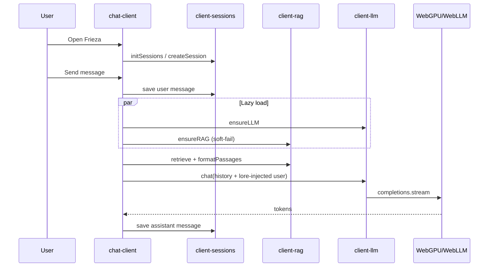

# Architecture — Dragon Ball Z Chat

How the system works **today** (GitHub Pages + optional local Python), then suggestions to improve it.

---

## 1. Big picture

Two runtimes share one repo:

| Mode | Where | Who generates replies |
|------|--------|------------------------|
| **Pages (visitor)** | Static site on GitHub Pages | Browser WebLLM (WebGPU) |
| **Local (dev)** | Python API + Vite proxy | Local LLM via `backend/` |

Visitors never hit a Python server. CI uses Python only at **build time** to rebuild the RAG index JSON that ships with the static site.

```
                    BUILD (GitHub Actions)
  ┌──────────────────────────────────────────────────────────┐
  │  canon texts → backend.rag (Chroma) → export_rag_index   │
  │       → frontend/public/rag-index.json                   │
  │  npm run build (PAGES_BASE=/dragonball-z-chat/)          │
  │       → frontend/dist → GitHub Pages                     │
  └──────────────────────────────────────────────────────────┘

                    RUNTIME (browser)
  ┌──────────────────────────────────────────────────────────┐
  │  UI: reel → summon → chat                                │
  │  Sessions: sql.js + localStorage                         │
  │  LLM: WebLLM Qwen2.5-1.5B (WebGPU)                       │
  │  RAG: lazy ensureRAG + retrieve on send (soft-fail)      │
  │  SW: cache wasm/json; network-first HTML                 │
  └──────────────────────────────────────────────────────────┘
```

---

## 2. Repo layout

```
dragonball-z-chat/
├── backend/                 # Local API + canon RAG (Python)
│   ├── api.py               # HTTP chat API (local only)
│   ├── model.py             # Local LLM completion
│   ├── rag.py               # Embed + Chroma index/retrieve
│   ├── sessions.py          # Server-side sessions
│   └── canon/               # Lore text (+ index/ at build)
├── frontend/
│   ├── public/              # Vite publicDir (wasm, sw, ref/, rag-index)
│   ├── src/
│   │   ├── main.ts          # Boot UI + register SW
│   │   ├── api/             # OpenAPI-typed client (local backend)
│   │   ├── chat/
│   │   │   ├── chat-client.ts   # ACTIVE chat UI (Pages path)
│   │   │   ├── chat.ts          # Older API-oriented chat (legacy)
│   │   │   └── sample.ts        # Frozen transcripts (optional)
│   │   ├── runtime/
│   │   │   ├── client-llm.ts      # WebLLM
│   │   │   ├── client-rag.ts      # Transformers.js RAG (unused in send)
│   │   │   └── client-sessions.ts # sql.js sessions
│   │   ├── reel/ summon/ splash/ characters/
│   └── vite.config.ts
├── scripts/export_rag_index.py
└── .github/workflows/pages.yml
```

---

## 3. Frontend runtime (Pages)

### Boot (`main.ts`)

1. Register service worker (`BASE_URL + sw.js`)
2. Log WebGPU availability (does not gate UI)
3. Start reel + splash always (non-WebGPU still sees the site)

### Chat open (`chat-client.ts`)

1. `initializeLocalApp()` → `initSessions()` + `initLLM()` (fire-and-forget on create)
2. If `VITE_FROZEN_CHAT=1` → show `sample.ts` transcript (no live model)
3. Else → `await initSessions()`, create/load local session, show form

### Send (live path)

```
user text
  → saveLocalMessage (sql.js)
  → ensureLLM (lazy) + ensureRAG (lazy, soft-fail)
  → retrieve(user text) → top 3 hits above MIN_SCORE (skip thin stubs)
       ├─ no hits → character chat @ temp 0.7
       └─ hits → extractFact (same WebLLM, cold) → formatFact
            └─ UNKNOWN/fail → formatPassages fallback
  → optional memory from loadMemory()
  → conversation history ending in user message
  → inject fact/lore into last user prompt for the model only
  → client-llm.chat(character, messages, { temperature: lore ? 0.35 : 0.7 })
       prepends character SYSTEM_PROMPTS[id]
       streams tokens via WebLLM
  → save assistant message (plain text; lore not persisted)
```

See [PLAN-rag-wireup.md](./PLAN-rag-wireup.md) and [PLAN-rag-quality.md](./PLAN-rag-quality.md).

### Model

- **ID:** `Qwen2.5-1.5B-Instruct-q4f16_1-MLC` (~2.5 GB VRAM est.)
- **Engine:** `@mlc-ai/web-llm` + WebGPU
- First visit downloads weights into browser cache; later loads are faster
- Gated by `assessDevice()` (WebGPU adapter + RAM heuristic)

### Sessions

- **sql.js** WASM from `BASE_URL + sql-wasm.wasm`
- DB blob in **localStorage** (`dbz-sqlite-db`)
- Tables: `sessions`, `memories`

### Service worker

- Cache name `dbz-static-v2`
- **Network-first** for HTML (avoids stale Vite asset hashes after redeploy)
- Cache-first for hashed `/assets/*` and wasm
- Separate model cache for HF / models paths

---

## 4. Backend (local / CI only)

### Local chat API

Vite proxies `/api` → `http://127.0.0.1:8787`.  
`frontend/src/api/api.ts` talks to that API. **Pages does not use it.**

### RAG pipeline

1. Canon `.txt` under `backend/canon/`
2. `python -m backend.rag` → Chroma at `backend/canon/index/` (CUDA if available, else CPU)
3. `scripts/export_rag_index.py` → `frontend/public/rag-index.json` (docs + embeddings + metadata)

CI runs 2–3 before `npm run build` so Pages ships a fresh index.

---

## 5. Data / control flow (Pages visitor)



---

## 6. What works vs gaps

| Piece | Status |
|--------|--------|
| Static Pages deploy | Working |
| Reel / summon / chat UI | Working |
| WebLLM download + reply | Working (after message-order fix) |
| sql.js sessions | Working |
| BASE_URL for assets / wasm | Working |
| SW HTML freshness | Working (v2) |
| Frozen sample fallback | Code present; **not** forced in CI |
| Client RAG module | **Wired on send** (lazy + soft-fail) |
| Non-WebGPU live chat | UI loads; LLM init fails — no graceful frozen fallback on detect |
| Duo / partner streaming | Legacy API ideas remain; local path is single-speaker |
| Progress UI for model load | Console only |

---

## 7. Suggestions (better architecture)

Ordered by impact for the next steps you mentioned (wire RAG, then harden).

### A. Wire client RAG into send — done

See [PLAN-rag-wireup.md](./PLAN-rag-wireup.md). Soft-fail + status line shipped; optional “Using lore: …” chip still open if UX wants it.

### B. Clear runtime modes

Explicit mode enum instead of scattered flags:

- `live` — WebGPU + LLM (+ RAG when ready)
- `frozen` — sample transcripts (no WebGPU or LLM failed)
- `loading` — model downloading (disable send, show %)

Auto-switch: if `initLLM` fails → frozen or clear error with retry.

### C. One chat module

`chat.ts` (API) vs `chat-client.ts` (Pages) duplicates UX. Prefer one façade:

- `ChatBackend` interface: `createSession`, `send`, `listHistory`
- Implementations: `LocalBackend` | `HttpBackend`

### D. Message pipeline hygiene

- Cap history window (e.g. last N turns) so context fits 1.5B
- Don’t dump entire memory as fake user/assistant turns; prefer system or a single prefixed user turn
- Persist streaming once at complete (or throttle UI updates)

### E. Assets & UX

- Add `favicon.ico` under `public/` (or link with `BASE_URL`) to silence 404
- On-page model download progress (reuse existing `onProgress`)
- Lazy-load WebLLM chunk only when chat opens (smaller first paint)

### F. RAG performance

- `rag-index.json` can be huge; consider:
  - gzip / split shards
  - quantized / fewer dims export if quality allows
  - retrieve in a Worker so UI stays responsive
- Precompute nothing in the browser that CI already embedded — only embed the **query**

### G. Sessions storage

localStorage + base64 sqlite will hit size limits. Prefer **IndexedDB** for the sql.js dump (plan already mentioned IDB; code still uses localStorage).

### H. CI / build

- Cache HF / pip / chroma between runs (or commit a built `rag-index.json` artifact when canon is unchanged)
- Optional `HF_TOKEN` secret to avoid Hub rate limits on CPU index builds

### I. Keep Python for what it’s good at

Don’t resurrect a Pages API. Keep Python for:

- Canon ingestion & index quality
- Eval (`backend/eval`)
- Local full-stack debug

Browser owns inference + session UX for visitors.

---

## 8. Suggested next milestone

1. ~~**Capability gate + small WebLLM**~~ — [PLAN-webllm-capability.md](./PLAN-webllm-capability.md)
2. ~~**Wire RAG** into send~~ — [PLAN-rag-wireup.md](./PLAN-rag-wireup.md)
3. **Frozen / soft fallback** when WebGPU or RAM fails (right branch stub)
4. **IndexedDB** for session persistence
5. Collapse dual chat clients behind one backend interface
